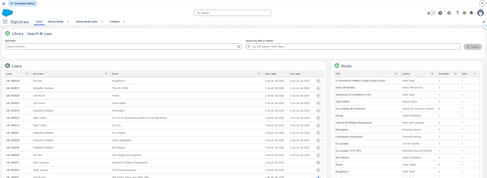
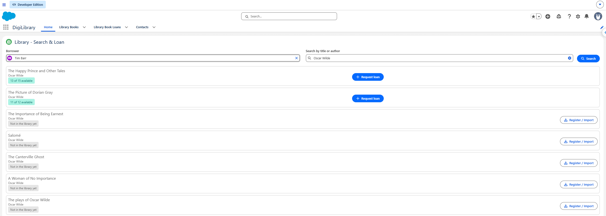
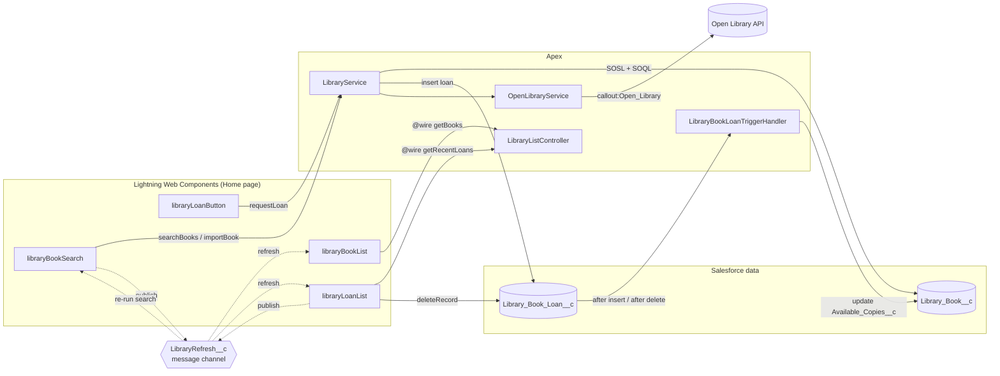

# DigiLibrary — Book Management on Salesforce

A Salesforce app for a corporate digital library: it tracks the book inventory,
lets employees search for books by title or author, and registers loans and
returns while keeping the available-copy count correct.

Built for the **StrongCRM Apex Developer Challenge**, including the optional
**Extra Challenge** (integration with the public
[Open Library](https://openlibrary.org) API).



---

## Contents

- [Features](#features)
- [Architecture](#architecture)
- [Data model](#data-model)
- [Apex](#apex)
- [Lightning Web Components](#lightning-web-components)
- [Open Library integration (Extra Challenge)](#open-library-integration-extra-challenge)
- [Design decisions](#design-decisions)
- [Tests and coverage](#tests-and-coverage)
- [Setup and deployment](#setup-and-deployment)
- [Project structure](#project-structure)
- [Known gotchas](#known-gotchas)
- [Further documentation](#further-documentation)

---

## Features

| Requirement | How it is delivered |
|---|---|
| Register a loan only when copies are available, with proper error handling | `LibraryService.loanBook` throws `NoAvailableCopiesException`; the trigger also blocks the insert with `addError`, so the rule cannot be bypassed through the standard UI, Data Loader or the API |
| Decrease available copies when a loan is registered | `LibraryBookLoanTrigger` (after insert) |
| Increase available copies when a loan is removed | `LibraryBookLoanTrigger` (after delete) |
| Search books by title or author (SOSL) | `LibraryService.searchBooks` + LWC `libraryBookSearch` |
| Show book details, available copies and a "Request Loan" button | Result cards with a copy badge and an embedded `libraryLoanButton` |
| **Extra:** external API integration | Open Library search through a Named Credential, merged with the local results, with one-click import into the catalogue |

On top of the challenge requirements:

- **Live lists on the Home page.** `libraryBookList` and `libraryLoanList`
  reload automatically through the `LibraryRefresh` Lightning Message Channel
  whenever a loan is created, a book is imported or a loan is deleted.
- **Return a book from the UI.** The loan list has a *Delete* row action with a
  confirmation dialog; the trigger puts the copy back into circulation.
- **User-friendly errors.** Every failure reaches the user as a toast with a
  clear message, never as a stack trace or a generic "internal server error".
- **English-only UI**, as the client required: labels, buttons, toasts and every
  Apex message that can appear on screen.



---

## Architecture



### Loan request flow

1. The user picks a **Borrower** (Contact) and clicks **Request Loan** on a result card.
2. `libraryLoanButton` calls `LibraryService.requestLoan(bookId, borrowerId)`.
3. `loanBook` locks the book row (`FOR UPDATE`), checks `Available_Copies__c`
   and throws `NoAvailableCopiesException` if there are none left.
4. Otherwise it inserts a `Library_Book_Loan__c` (start date today, due date +30 days).
5. The trigger (`after insert`) decreases `Available_Copies__c` on the book.
6. `requestLoan` turns any failure into an `AuraHandledException`, so the LWC
   shows the real message in a toast.
7. On success the button fires a `loancreated` event; the search component
   re-runs the search and publishes on `LibraryRefresh`, and both lists reload.

Returning a book is the reverse: deleting the loan in `libraryLoanList` fires
the `after delete` trigger, which adds the copy back, and the channel refreshes
every component on the page.

---

## Data model

### `Library_Book__c` — Library Book

| Field | Type | Notes |
|---|---|---|
| `Name` | Text | The title is **written** here |
| `Title__c` | Formula (Text) = `Name` | Read-only; used by SOQL/SOSL and the UI |
| `Author__c` | Text | |
| `Total_Copies__c` | Number(18,0) | |
| `Available_Copies__c` | Number(18,0) | Maintained by the trigger |

### `Library_Book_Loan__c` — Library Book Loan

| Field | Type | Notes |
|---|---|---|
| `Name` | Auto Number `LBL-{000000}` | |
| `Book__c` | Lookup → `Library_Book__c` | |
| `Borrower__c` | Lookup → `Contact` | |
| `Loan_Start_Date__c` | Date | Set to today by `loanBook` |
| `Loan_End_Date__c` | Date | Today + 30 days |

---

## Apex

| Class | Responsibility |
|---|---|
| `LibraryBookLoanTrigger` | Thin trigger (`after insert`, `after delete`) that delegates to the handler |
| `LibraryBookLoanTriggerHandler` | Bulkified inventory sync: groups loans by book, **one SOQL (`FOR UPDATE`) and one DML** per transaction, validates availability and adjusts `Available_Copies__c` |
| `NoAvailableCopiesException` | Custom exception for loans requested on books with no copies left |
| `LibraryService` | Service layer — see the methods below |
| `OpenLibraryService` | HTTP client for the Open Library Search API; never throws |
| `LibraryListController` | Read-only, `cacheable=true` queries for the list components (`getBooks`, `getRecentLoans`, limit 200 rows) |

### `LibraryService` methods

| Method | Exposed to | What it does |
|---|---|---|
| `searchBooks(String searchTerm)` | `@AuraEnabled` (not cacheable, because it makes a callout) | Merges the local SOSL search with Open Library results into a list of `BookSearchResult` rows (`source = LOCAL` or `EXTERNAL`). Requires at least 2 characters, escapes SOSL operators, caps results at 50 and removes duplicate titles (the local row wins) |
| `importBook(String title, String author)` | `@AuraEnabled` | Creates a `Library_Book__c` with 1 copy from an external result; returns the existing Id when the title is already in the catalogue |
| `loanBook(Id bookId, Id borrowerId)` | Apex | The domain method the challenge asks for: validates input, locks the book, throws `NoAvailableCopiesException` and inserts the loan |
| `requestLoan(Id bookId, Id borrowerId)` | `@AuraEnabled` | LWC wrapper around `loanBook` that converts every exception into an `AuraHandledException` with a readable message |

---

## Lightning Web Components

| Component | Targets | Description |
|---|---|---|
| `libraryBookSearch` | App, Home, Tab | Search box with an explicit **Search** button (or Enter), borrower picker and result cards. Local rows show an availability badge (green/red) and a loan button; external rows show a **Register / Import** button. Subscribes to `LibraryRefresh` so a loan deleted elsewhere updates its rows |
| `libraryLoanButton` | Record page (`Library_Book__c`), App, Home | Reusable *Request Loan* button. Works on a book record page (uses `recordId` and its own Contact picker) or embedded in a list (receives `bookId` / `borrowerId`). Shows success/error toasts and fires `loancreated` |
| `libraryBookList` | App, Home, Tab | Book catalogue datatable (title, author, available, total) that refreshes through the message channel |
| `libraryLoanList` | App, Home, Tab | Most recent loans (loan, borrower, book, start date, due date) with a **Delete** row action (`LightningConfirm` + `deleteRecord`) that returns the copy |

**Message channel `LibraryRefresh__c`** — fields `source` (which component
published) and `bookId` (the book affected). Used with `APPLICATION_SCOPE`.

---

## Open Library integration (Extra Challenge)

- **Named Credential `Open_Library`** → `https://openlibrary.org`, anonymous,
  no authentication. The URL lives in metadata, not in code
  (`callout:Open_Library/search.json`).
- **`OpenLibraryService.search(term)`** requests
  `?limit=10&fields=title,author_name&q=<term>` with a 10-second timeout and
  maps each result to `ExternalBook(title, firstAuthor)`.
- **Resilient by design:** a non-200 status, a `CalloutException` (DNS,
  timeout, credential misconfiguration) or an unexpected JSON shape is logged
  with `System.debug(WARN)` and returns an empty list. The search then shows
  local results only instead of breaking the page.
- **Import:** an external-only row can be added to the catalogue with one click
  (`importBook`) and can be loaned right away.

---

## Design decisions

- **`addError` in the trigger, `throw` in the service.** The trigger flags the
  failing loan with `addError(new NoAvailableCopiesException(...))`: the
  standard UI and Data Loader show a clean message with no stack trace, and a
  bulk insert still saves the loans that can be fulfilled. `loanBook` throws the
  custom exception *before* any DML, as the challenge requires.
- **Separate domain method and `@AuraEnabled` wrapper.** Only
  `AuraHandledException` messages reach the client; a raw custom exception
  would show up in the LWC as a generic "internal server error". `requestLoan`
  does the translation so `loanBook` stays a clean Apex API.
- **Row locking (`FOR UPDATE`)** in both `loanBook` and the trigger handler
  prevents two concurrent requests from loaning the last copy twice.
- **Explicit Search button instead of search-as-you-type.** Since the search
  calls an external API, firing it on every keystroke would send one callout
  per letter. The search is imperative and runs only when the user asks.
- **SOQL backfill for SOSL index lag.** The SOSL index is not updated
  synchronously, so a book imported a moment ago could come back as "external"
  on the next search (an intermittent bug found during testing). `searchBooks`
  also runs an exact-title SOQL query (`WHERE Name IN :externalTitles`), and the
  LWC flips the imported row to "local" optimistically.
- **Custom list components + LMS instead of standard list views.**
  `RefreshEvent` did not reload the standard list views on the Home page, so
  the lists are custom LWCs (`@wire` + `refreshApex`) driven by the
  `LibraryRefresh` message channel.
- **`with sharing`** on all service/controller classes, so record access
  follows the running user's sharing rules.

---

## Tests and coverage

### Apex — 38 tests, 99% org-wide coverage

| Test class | Tests | Covers |
|---|---|---|
| `LibraryServiceTest` | 18 | Search (blank/short term, local rows, SOSL escaping, merge with external rows, external failure, SOQL backfill), import (new, existing title, blank title, DML failure), `loanBook` and `requestLoan` success and error paths |
| `OpenLibraryServiceTest` | 9 | Mapped results, blank term without callout, HTTP error, callout exception, malformed/non-object JSON, missing `docs`, skipped invalid entries |
| `LibraryBookLoanTriggerTest` | 8 | Decrement on insert, increment on delete, bulk insert, no copies (friendly error), partial bulk success, null `Available_Copies__c`, loan without book |
| `LibraryListControllerTest` | 2 | `getBooks` ordering, `getRecentLoans` with related names |
| `NoAvailableCopiesExceptionTest` | 1 | Exception type and message |

Supporting classes: `LibraryTestDataFactory` (test data) and
`OpenLibraryCalloutMock` (`HttpCalloutMock`), both `@IsTest`.

| Class | Coverage |
|---|---|
| `LibraryBookLoanTrigger` / `LibraryBookLoanTriggerHandler` | 100% |
| `OpenLibraryService` | 100% |
| `LibraryListController` | 100% |
| `LibraryService` | 99% |

The challenge's minimum is 85%.

### LWC (Jest) — 29 tests, ~94% line coverage

One suite per component, under `force-app/main/default/lwc/*/__tests__/`:
`libraryBookSearch` (10), `libraryLoanButton` (7), `libraryLoanList` (7),
`libraryBookList` (5).

### Running the tests

```bash
# Apex (against the default org)
sf apex run test --test-level RunLocalTests --code-coverage --result-format human --wait 10

# LWC (requires Node >= 20 — sfdx-lwc-jest 7)
npm install
npm test
npm run test:unit:coverage
```

---

## Setup and deployment

### Prerequisites

- [Salesforce CLI](https://developer.salesforce.com/tools/salesforcecli) (`sf`)
- Node.js **20 or newer** (for Jest, ESLint and Prettier)
- A Salesforce org (Developer Edition, sandbox or scratch org). API version **65.0**

### Deploy

```bash
# 1. Authorize the org
sf org login web --alias digilibrary --set-default

# 2. Deploy the message channel first — the LWCs import it and do not compile without it
sf project deploy start --source-dir force-app/main/default/messageChannels

# 3. Deploy everything else
sf project deploy start --manifest manifest/package.xml

# 4. Run the Apex tests
sf apex run test --test-level RunLocalTests --code-coverage --wait 10
```

### Configure the UI

The Lightning app and its Home page are not stored in this repository. After
deploying:

1. In **App Builder**, create (or edit) a Home page or App page and add
   **Library Book Search**, **Library Book List** and **Library Loan List**.
2. Optionally add **libraryLoanButton** to the `Library_Book__c` record page.
3. Create a few `Library_Book__c` records (fill in `Name`, `Author__c`,
   `Total_Copies__c`, `Available_Copies__c`) and at least one Contact to use as
   a borrower — or import books straight from the Open Library results.

### Code quality

```bash
npm run lint          # ESLint on LWC
npm run prettier      # format Apex, LWC, XML, etc.
```

A Husky `pre-commit` hook runs `lint-staged`: Prettier on staged files, ESLint
on LWC JavaScript and the related Jest tests.

---

## Project structure

```
force-app/main/default/
├── classes/
│   ├── LibraryService.cls                  # search, import, loan
│   ├── OpenLibraryService.cls              # external API client
│   ├── LibraryListController.cls           # cacheable list queries
│   ├── LibraryBookLoanTriggerHandler.cls   # inventory sync
│   ├── NoAvailableCopiesException.cls
│   ├── LibraryTestDataFactory.cls          # @IsTest
│   ├── OpenLibraryCalloutMock.cls          # @IsTest
│   └── *Test.cls                           # Apex test classes
├── triggers/LibraryBookLoanTrigger.trigger
├── lwc/
│   ├── libraryBookSearch/
│   ├── libraryLoanButton/
│   ├── libraryBookList/
│   └── libraryLoanList/                    # each with __tests__/
├── messageChannels/LibraryRefresh.messageChannel-meta.xml
├── namedCredentials/Open_Library.namedCredential-meta.xml
└── objects/
    ├── Library_Book__c/
    └── Library_Book_Loan__c/
manifest/package.xml                        # deployment manifest
docs/                                       # overview, artifacts and build notes
```

---

## Known gotchas

- **`Title__c` is a formula field** (`= Name`), so it cannot be written. Create
  or rename books through `Name`; queries and the UI read `Title__c`.
- **Deploy order matters:** `LightningMessageChannel` must be listed in
  `manifest/package.xml` and exist in the org before the LWCs that import
  `@salesforce/messageChannel/LibraryRefresh__c`. Otherwise the deploy fails
  with `Unable to retrieve metadata for descriptor ... LibraryRefresh__c`.
- **SOSL needs at least 2 characters** and its index lags a few seconds behind
  inserts (see the SOQL backfill above).
- **The Jest runner needs Node ≥ 20.** On Node 18 `sfdx-lwc-jest` 7 does not run.

---

## Further documentation

- [`docs/OVERVIEW.md`](docs/OVERVIEW.md) — what the app does, in plain language.
- [`docs/README.md`](docs/README.md) — index of the supporting material.
- [`docs/artifacts/deliverables-inventory.html`](docs/artifacts/deliverables-inventory.html) — full inventory of objects, Apex classes, components and the requirements map.
- [`docs/artifacts/loan-flow-swimlane.html`](docs/artifacts/loan-flow-swimlane.html) — swimlane diagram of a loan request across LWC, Apex, Open Library and the trigger.
- [`docs/artifacts/field-guide.html`](docs/artifacts/field-guide.html) — study guide with a log of design decisions and a self-check quiz.
- `docs/vault/` — the task and knowledge notes written during the build.

---

**Author:** Carlos Silva — StrongCRM Apex Developer Challenge, 2026.
